# Swasthya Saathi

Help patients explain their visit in their own language and give clinicians a handoff they can trace to the patient's words.

For primary-care intake workers assisting patients in **Hindi, Tamil, Telugu, Kannada and English**. Sarvam handles voice, translation and bounded extraction; the worker and patient confirm the translation and a human reviewer accepts the handoff.

## Five-step demo

1. Run `npm run build && npm run dev`, open `http://127.0.0.1:4317`, choose a language and load a fictional medication case. Samples are prewritten and free.
2. Press **Prepare back-translation**, **Read back to patient**, read the displayed sample aloud, check the patient-confirmation box and **Confirm translation**.
3. **Extract reported facts**, inspect the quoted evidence and proposed values, answer optional clarifications or leave unknown details blank, then continue to review.
4. Enter a reviewer reference, choose **Hackathon demo reviewer**, check critical details and accept. Edit a fact to demonstrate that approval resets.
5. Create the reviewed handoff and export text or JSON. Open [evaluation evidence](https://swasthya-saathi-935048564575.asia-south1.run.app/evidence.html) and distinguish historical measured results from the new v3 implementation.

The [two-minute walkthrough](demo.html) follows the same path. Live processing uses the same controls with consent and an owner or capped judge token. No credentials are included.

## Three measured numbers

| Historical live measurement                     | Result    |
| ----------------------------------------------- | --------- |
| Distinct fictional text cases completed         | **30/30** |
| Exact fact recall on the frozen 20-case holdout | **93.0%** |
| Exact fact precision on that holdout            | **86.8%** |

These are the preserved intake-v2 results, not v3 scores. Inspect [the evidence page](https://swasthya-saathi-935048564575.asia-south1.run.app/evidence.html), [raw results](evals/results/text-live.json) and [failure analysis](docs/implementation-phases.md). The current source is **intake-v3**; its approved first paid holdout stopped after 4/16 cases (3 valid, 1 validation failure). See [the partial-run results](docs/v3-holdout-results.md); deployment remains pending. The public Cloud Run deployment remains v2.2 until then.

## Architecture

```mermaid
flowchart LR
 A[Patient voice or text] --> B[Saaras ASR and editable original]
 B --> C[English translation]
 C --> D[Back-translation and readback]
 D --> E[Patient confirmation]
 E --> F[Bounded extraction and validation]
 F --> G[Up to three targeted clarifications]
 G --> H[Evidence, proposed values, review flags]
 H --> I[Human approval and local export]
```



Application code owns the plan; model output never executes tools. The extraction model is `sarvam-105b`, with strict JSON output, 2,200 output tokens per call, one transient retry, one repair and an absolute **three-call ceiling** per extraction. One optional clarification pass permits at most six model calls across a visit. Questions are requested in the extraction response, not a separate model call. Translation/localized question/readback requests are separate, explicitly bounded UI operations with existing timeouts.

Shared sentence segmentation protects decimals, abbreviations, danda and newlines. Facts retain whole-source quotations. Optional proposed values require exact quote tokens and remain beside their evidence; unsupported values are removed with a flag. Deterministic multilingual rules flag selected instructions, uncertainty, corrections and family context. Original words, clarification translations, human corrections and translation confirmation remain visible and export separately.

Modules: browser orchestration in `app.js`; media/workflow/review/export/i18n in `modules/`; schema and provenance in `agent.js`; bounded provider orchestration in `harness.mjs`; protected routes in `server.mjs`; request budgets in `demo-access.mjs`. See [architecture](docs/architecture.md), [v3 prompt](prompts/intake-v3.mjs) and [v3 schema](prompts/intake-v3.schema.json).

## Run and verify

Node 22 or later; **zero runtime dependencies**.

```sh
npm test
npm run eval
npm run build
npm run dev
# Optional pinned development formatter:
npx --yes prettier@3.6.2 --check .
```

`npm run eval` is free: 30 historical fixture replays plus 16 hash-frozen v3 label/schema checks. The new holdout was partially run live (4/16 cases) and has not been used for tuning; offline replay is still fixture consistency only. CI runs tests, offline evaluation and build. [Per-phase changes and checks](docs/implementation-phases.md) record each separate commit.

For live processing, supply `SARVAM_API_KEY` and `LIVE_ACCESS_TOKEN` (32+ characters) through environment injection/Secret Manager. `SARVAM_TEXT_MODEL` optionally selects `sarvam-105b-conversations`. Speech uses `saaras:v3`, translation `sarvam-translate:v1` and playback `bulbul:v3`. Enter the app access token in the page's access section; it stays in memory. Local `.env` files are not automatically loaded.

The server enforces same-origin requests, explicit consent, access-token comparison, 5 MB bodies and provider timeouts. The HTTP adapter permits two active paid requests and 30 POSTs/minute per instance; production currently uses max one instance. Browser recording stops at 25 seconds. No database, application content logs or local storage hold patient data; exports leave the ephemeral session under operator control.

## Judge access

A separate `DEMO_ACCESS_TOKEN` can enable an expiring, shared **request-capped** demo without sharing the owner token. All settings must be present: token, `DEMO_REQUEST_LIMIT`, absolute `DEMO_EXPIRES_AT`, and `DEMO_BUDGET_BUCKET`. Counter metadata is atomically updated in private Cloud Storage so restarts/concurrent instances do not reset the cap. Consent and all other gates still apply. Missing/unavailable budget storage denies requests.

No demo secret, bucket or permissions were created. [Judge-access setup](docs/judge-access.md) describes the approval-dependent configuration. The bucket holds a hashed budget identifier and count only, never patient text/audio. Caps count authenticated POST attempts, including failed requests; an extraction attempt can contain up to three model calls.

## Live evaluation and deployment approval

[The prepared live-run plan](docs/live-run-plan.md) includes commands, expected costs and recording-manifest instructions. The approved first v3 holdout was attempted on 18 November 2026 and stopped on its first failure; [results](docs/v3-holdout-results.md) are preserved. Seven requests cost an estimated ₹0.23 before GST without cache discounts, below the approved ₹15 allowance. The remaining twelve cases were not run. Other suites require separate approval.

Human-recorded fictional audio can replace synthesized audio through `evals/audio-loader.mjs` and `evals/human-speech.mjs`; no recordings were fabricated. Use the ignored `evals/audio-private/` folder and supply actual reference transcripts plus speaker/upload consent.

Deployment is a separate approval step after evaluated results are reviewed. Build first, preserve Secret Manager bindings, deploy the existing `swasthya-saathi` Cloud Run service in `asia-south1`, and smoke-test synthetic content. [Deployment/rollback details](docs/architecture.md#deployment-and-rollback) and [private GitHub source](https://github.com/gowtham66867/swasthya-saathi).

## Limitations

- Synthetic communication prototype: no diagnosis, prescribing, urgency assessment, EHR integration, clinical validation or regulatory claim.
- Historical exact-span agreement is not clinical accuracy. Held-out ambiguity quote recall was 0; allergy-category errors affected negation matching. The partial v3 run passed three cases and failed one; full-suite values, questions and multilingual behavior remain unverified.
- Native text/patterns are author-written and await fluent-speaker review. Number/unit/negation checks and back-translation cannot establish semantic equivalence. Confirmation and reviewer roles are self-attested, not authenticated patient/clinician identity.
- Historical speech results use quiet same-provider synthetic audio. Human speech, accents and clinic noise remain unmeasured. No time-saving benefit has been demonstrated.
- Workflow state is browser-owned and not server-attested. Shared access tokens are prototype gates, not clinical identity management. Audio duration is not independently decoded server-side; size is enforced. Sarvam processes live content under its own policies; infrastructure may retain request metadata, and local exports/clipboard copies remain with the operator.
- Judge request caps are not INR spending caps. Durable storage must be configured and verified before judge access is enabled. [Independent validation kit](docs/validation-kit.md) lists the remaining human work.
