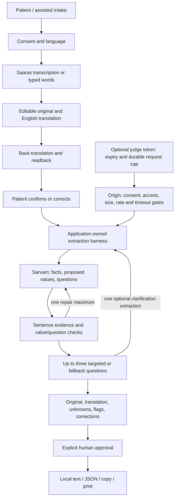

# Architecture



The model proposes data, never executable tools. Application code owns all operations and state transitions. The clarification loop has one pass. Model question localization reuses the translation route; it does not call the extraction model again. English questions and their motivating quotes remain visible to the worker.

## Modules

| Module                                | Responsibility                                                                      |
| ------------------------------------- | ----------------------------------------------------------------------------------- |
| `app.js`                              | Browser orchestration and event wiring                                              |
| `modules/recording.js`                | Ephemeral capture, stop/cancel, TTS playback and stream cleanup                     |
| `modules/workflow.js`                 | State machine, revision and translation confirmation                                |
| `modules/review.js`                   | Fact/value/question rendering and correction invalidation                           |
| `modules/export.js`                   | Reviewed text/JSON packets and local downloads                                      |
| `modules/i18n.js`                     | Five patient locales; root `locale.js` retains compatible exports                   |
| `agent.js`                            | v3 schema, evidence validation, fallback questions and handoff                      |
| `sentence.js`                         | Shared Intl sentence segmentation with protected punctuation                        |
| `values.js`, `questions.js`           | Field/token checks and rejected-proposal fallback                                   |
| `review-tools.js`, `rule-patterns.js` | Deterministic multilingual review flags                                             |
| `translation-checks.js`               | Number/unit/negation marker comparisons and confirmation matching                   |
| `harness.mjs`                         | Fixed extraction plan, bounded retry/repair, telemetry                              |
| `server.mjs`, `access.mjs`            | API gates, constant-time token comparison and Sarvam routes                         |
| `demo-access.mjs`                     | Optional expiring judge access and durable non-patient counter                      |
| `scripts/dev.mjs`                     | HTTP adapter, streaming body cap, concurrency and shared rate limits                |
| `scripts/build.mjs`                   | Dependency-free static/server asset packaging                                       |
| `evals/`                              | Synthetic fixtures, frozen holdout, approved live grading and recorded-audio loader |

## State and evidence

`created → consented → transcribed → translated → translation_confirmed → extracted → clarifying → awaiting_review → approved → exported`

Clarification is skipped when unnecessary. The main English version is back-translated (`direction: back`), read aloud and explicitly confirmed. English originals use identity back-translation; prewritten samples use labelled sample text and an operator-read attestation. Confirmation stores exact original/English/back-translation and time in browser memory. Source edits reset confirmation and dependent output; reviewer/field edits invalidate approval. Exports reject missing/stale confirmation. Live API calls require a confirmation assertion and the confirmed/clarifying stage; there is no persisted or cryptographically attested clinical workflow.

Source IDs in facts/questions are only `english` and `clarifications`. Original-language text and original clarification answers are independently scanned for review flags, not used as English quote sources. Shared segmentation protects decimals, common abbreviations, danda and hard newlines. Quotes must equal a complete segmented sentence or complete labelled clarification answer. Anchoring can expand contiguous source tokens to a unique full sentence, never paraphrase. Values must preserve exact names, full numeric tokens and units in that quote; unsupported proposals are removed with diagnostics. Questions have validated evidence and deterministic wording checks, with fixed-template fallback. These checks establish provenance, not clinical correctness.

Clarification answers retain original text and separate English translations. Their final patient/worker review is mandatory; the initial main-story back-translation record does not attest a separate reverse translation of every follow-up answer. All automatic flags remain visible through clarification and export.

## Budgets and privacy

At most three model calls per extraction: one transient retry and one repair, within the ceiling. One optional clarification pass yields at most six model calls per visit. Model calls: 2,200 maximum output tokens and 25-second timeout each. Provider translation/speech calls: 45-second timeout. HTTP operation deadline 80 seconds; Cloud Run timeout 90 seconds. Explicit back-translation preparation adds one translation call (identity/sample paths add none), readback adds TTS, and proposed question localization adds at most three translation calls per extraction display.

Browser capture stops at 25 seconds; server limits bodies to 5 MB, including chunked input. Two active paid requests and 30 POSTs/minute per instance; deployment currently capped at one instance. Cancellation and revision checks discard stale completions. No application patient database, local storage or transcript logs. Audio and source text remain ephemeral; local exports are operator-controlled. Sarvam processes live content under its policies; infrastructure request metadata may be retained.

Optional judge access uses a separate token, expiry and atomic Cloud Storage counter. Only hashed budget IDs and counts persist; no patient content. Missing/unavailable counter storage fails closed. See [judge setup](judge-access.md). Actual IAM/GCS integration requires an approved cloud test.

## Evaluation

Historical v2/v2.2 results stay unchanged. `npm run eval` replays 30 historical labels and validates a new hash-frozen 16-case v3 holdout offline. The first v3 paid run stopped after four cases (three valid, one validation failure); its first/partial report cannot be overwritten. See [the results](v3-holdout-results.md). Human-recorded fictional audio is accepted only through a consented manifest; no recordings are bundled. [Failure investigation](implementation-phases.md) and [commands/costs for approval](live-run-plan.md) separate historical evidence, regression and future holdout measurements.

## Deployment and rollback

Deployment needs fresh approval. Existing project `swasthya-saathi-2026`, service `swasthya-saathi`, region `asia-south1`. CI verifies code but never deploys.

```sh
npm test
npm run eval
npm run build
# Only after approval; preserve existing service account and secret bindings:
gcloud run deploy swasthya-saathi --source . --project=swasthya-saathi-2026 --region=asia-south1 --min-instances=0 --max-instances=1 --concurrency=10 --memory=512Mi --cpu=1 --timeout=90 --quiet
# Inspect revisions before selecting a rollback target:
gcloud run revisions list --service=swasthya-saathi --project=swasthya-saathi-2026 --region=asia-south1
# Replace PREVIOUS_REVISION with the verified revision:
gcloud run services update-traffic swasthya-saathi --to-revisions=PREVIOUS_REVISION=100 --project=swasthya-saathi-2026 --region=asia-south1
```

Docker copies built assets and the Node adapter only. Ignore files exclude credentials and Git metadata. Attach secrets via explicit Secret Manager versions; never put values in commands or source. Judge access remains off until separately provisioned/approved. The currently deployed revision remains v2.2 while v3 is reviewed locally.

## v3.1 provider evidence protocol

The strict provider schema selects catalog IDs, not generated quote/source strings. Application code materializes the exact original sentence before the unchanged public fact/value/question validators. This avoids provider copying corruption around clock abbreviations and decimal doses without accepting altered text. Missing/unknown IDs remain invalid; unsafe questions use template fallback. The existing call/repair ceilings and token limit are unchanged. Finish reason, parse/reference status and content-free validation categories are retained in metadata. Synthetic development traces and limits are in [the fix report](time-fix-results.md); the historical holdout remains unchanged.
