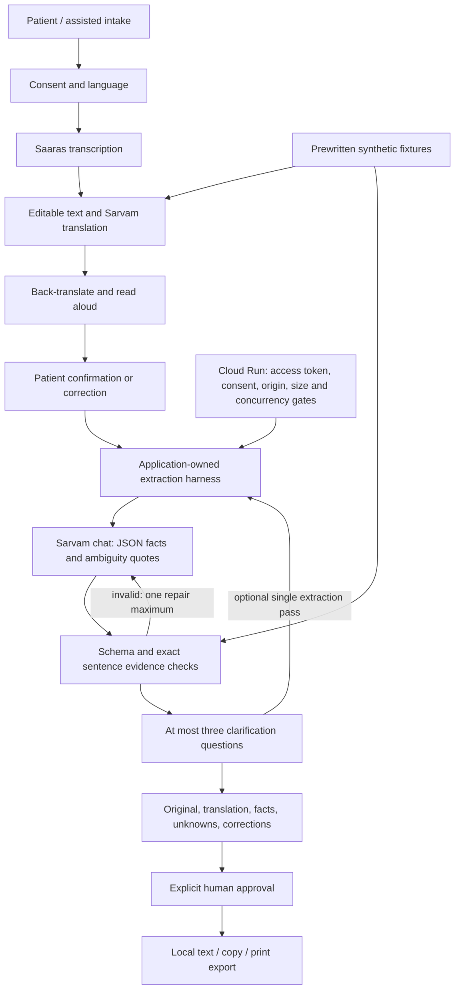

# Architecture

The diagram's clarification loop is bounded by the page to one pass. The model has no tool execution capability; application code owns all transitions. Authentication gates provider requests. Clinical workflow state stays in the browser and is not a server-attested record.

## Modules

| Module | Responsibility |
| --- | --- |
| `app.js` | Recording, cancellation, review, rendering and ephemeral workflow |
| `agent.js` | State machine, schema, source validation, questions and export |
| `harness.mjs` | Fixed extraction plan, response validation, retry/repair ceiling and usage |
| `prompts/` | Versioned model prompt and published schema |
| `server.mjs` | Same-origin, consent and token gate; Sarvam API routes |
| `scripts/dev.mjs` | Node HTTP adapter, streaming size cap, timeout and shared limits |
| `scripts/build.mjs` | Static asset packaging and server dependency copying |
| `evals/` | Synthetic labels, fixture consistency and opt-in live grading |

## Evidence and trust

Original text and translated English are separate sources. English extraction spans establish provenance in the translated text only. Patient clarifications are another source, and operator corrections are explicitly labelled human edits. Full sentence matching prevents simple negation trimming but cannot prove relevance, medical meaning, or truthful source reporting. Qualified review remains essential.

## State and budgets

`created → consented → transcribed → translated → translation_confirmed → extracted → clarifying → awaiting_review → approved → exported`

Clarification can be skipped if no questions are needed. Typing follows the same transcribed state without claiming speech processing. Samples use prewritten original, English and extraction labels. Edits invalidate dependent output; cancellation aborts the network request and discards stale results.

At most three model calls per extraction, one optional clarification pass, 2200 output tokens per call, 25 seconds per model call, 80-second server operation deadline, 90-second Cloud Run request timeout. Browser audio capture is 25 seconds; server body limit is 5 MB. Two active paid calls and 30 POST requests/minute per instance; deployment capped at one instance.

## Validation limits

Thirty fixtures cover ten scenarios translated into three language pairs. Offline replay cannot validate model performance. Live text extraction, translation and speech evaluations are separate future measurements. Browser tests exercise the sample workflow and invalidation; provider tests use mocks until keys are configured.

## Review and localization additions

`locale.js` supplies five patient locales; `review-tools.js` owns transparent, deterministic review flags and comparable timing calculations. English clinician review includes original clarification answers and their separately translated source. A reviewer reference, critical-detail check and explicit approval gate exports. Manual fallback has no extracted facts until an operator records corrections.

The extraction harness anchors a proposed contiguous token sequence to a unique full source sentence before validation. This preserves negation, qualifiers and dose numbers in the original sentence without accepting paraphrases. Anchoring cannot establish the correctness of the assigned category. Review rules reject instruction-like sentences and flag selected explicit corrections and uncertainty; they are not a clinical reasoning agent.

`evals/benchmark.mjs` separates development, frozen holdout and later regression retests. `evals/speech-live.mjs` measures four languages with synthetic audio and bounded provider retries. Published evidence keeps failures visible, labels reused translations in rechecks, and distinguishes estimates from actual credit debits. A prepared human-validation protocol is in `validation-kit.md`.

## Translation confirmation

Before extraction, the English version is back-translated through the existing translation route (`direction: back`), read aloud, and explicitly confirmed. English originals use identity back-translation; prewritten fixtures use labelled sample text and operator readback. Editing either source resets confirmation and all dependent output. Confirmation records the exact original, English, back-translation, time and readback self-attestation in ephemeral workflow state and exports. It is not server-attested patient identity. The API requires a confirmation assertion and the confirmed/clarifying stage; no clinical state is persisted.

Deterministic number, selected unit and negation-marker comparisons create review flags; they never silently repair text. Digit scripts are normalized for comparison. Word-number equivalence, negation scope and unlisted unit spellings need human review. Back-translation adds at most one translation request per explicit preparation, plus optional TTS readback; it does not add an extraction-model call or change the three-call extraction ceiling. Each request retains existing size, consent, access and timeout limits.
